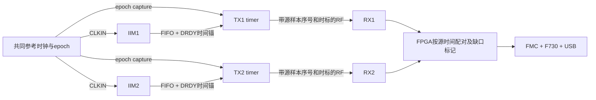

# 双通道采集物理时间对齐方案

## 结论

TX1/IIM1 和 TX2/IIM2 是两个独立采样节点。FPGA 同时给 RX1/RX2 一个 SYNC、同时发 START、或者让两个 RX 把第一帧编号归零，只能建立接收端逻辑起点，不能保证 IIM1/IIM2 的 ADC 采样发生在同一物理时刻。

本项目推荐先做“数据无线、采样参考时钟有线”的严格同步原型：一份共同参考时钟分配到两颗 IIM 的 CLKIN，采集端保留源样本计数、硬件时标、相位误差及有效性；只有实测相位误差上界小于指标的窗口才发布为物理对齐。若采集节点之间禁止任何同步线，则转为无线授时和重采样，明确交付“共同时间网格上的重建值”，不能把它称为原始样本同刻采集。

本文件是设计方案和验收合同；当前发布的双通道数据桥没有实现 TX 源时钟同步，不宣称物理对齐已完成。

## 已核对的器件事实

依据 TDK 官方 DS-000442 revision 1.5（2023-02-06），本地核对件在 diagnostics/MC012/sources：

- 第18页：IIM42352 第9脚复用 INT2 / FSYNC / CLKIN。
- 第82页：Bank1 INTF_CONFIG5(0x7B) 的 PIN9_FUNCTION[2:1]：00=INT2，01=FSYNC，10=CLKIN。因此不能在同一颗 IIM 上同时使用 CLKIN 和 FSYNC。
- 第16、22页：外部时钟支持 31–50kHz，手册说明 CLKIN 可改善 ODR 精度并把传感器采样点/周期联系到共同系统时钟；内部时钟模式 ODR 不确定度可达 ±8%。不能把 nRF 晶振的 ppm 直接当成 IIM 内部采样时钟的 ppm。
- 第56页：ODR 随外部时钟按 f_ext/32000 缩放；32.768kHz 下“4kHz 档”实际是4096Hz，不是4000Hz。FIFO 时间戳另有32.768/30或32/30的缩放要求，不能将原始计数直接当微秒。
- 第64、73、75页：FSYNC 记录标记边沿到 ODR 的时间差，支持相应 FIFO 标签；没有据此承诺 FSYNC 直接复位采样分频器或触发 ADC。

## 当前源码为何不能保证同步

1. TX FLPR 在 adc_sampler_read_samples 前用 k_uptime_get_32() 记录 capture_start_ms。FIFO 已经有旧样本时，这个值不是第一样本的 ADC 时刻。
2. CPUAPP 用 capture_start_ms 加“标量 offset/12000”合成每包时间戳。毫秒分辨率、FIFO 延迟、内部 ODR 漂移均未计入。
3. 每个 IIM 是4kHz的 XYZ 三轴向量输出；12000/s 是展开后的 int16 标量数，不是12000个不同采样时刻。一个 XYZ 三元组共享物理时间。当前4096标量的 batch 还会跨三元组边界，不能每个 batch 强制把首标量当 X。
4. RX 的 logical_sample_index 来自接收计数，丢包用“丢帧×96”估计；最后一帧可能不足96标量。因此它不能代替源绝对样本序号。
5. 旧 FPGA 用 ARM 标志直接输出 sync_locked。本轮改为没有源采样证明时 locked_mask=0；双通道 RX V1 也不再设置物理 SYNCED 位。

## 推荐架构：共同采样时钟 + 源时标 + 有界发布

### 时钟与接线

- 使用同一份低抖动参考源和分配缓冲，不是两个独立“同频率”的振荡器。优先32.000kHz保留4kHz采样率；32.768kHz也可，但所有采样率、包时长及时间戳换算必须改成4096Hz。
- 两条时钟支路分别接 IIM1/IIM2 第9脚，另以共同 epoch 边沿送入两个 TX 的空闲输入，由 GPIOTE→DPPI→TIMER 捕获。epoch 不再接 IIM FSYNC，因为第9脚已选 CLKIN。
- 两颗传感器 INT1 用作 DRDY 或经过明确定义的 FIFO 时间锚；VDDIO、电平转换、走线及终端方案依实际集成板原理图确认。当前组员工程只证明 SPI/INT1，未证明第9脚引出；不得向未确认的焊盘盲接时钟。
- SPI 初始化顺序可以不同；共同外部时钟本身不能代替对初始分频相位/滤波群延迟的核验。必须测 DRDY 相位、完成相同 ODR/滤波配置的读回，并在每次重新上电后重新获取相位关系。若无法使原始采样相位落在指标内，则只允许重采样或更换具有明确同步触发/分频复位能力的传感器，不能靠软件宣称严格同刻。

### 采集端协议 V2（待实现，不能混用 V1）

每个源帧至少携带：

| 字段 | 作用 |
| --- | --- |
| protocol_version、node_id、boot_id、sync_epoch | 区分协议、节点、重启和同步会话 |
| first_vector_index、vector_count、axis_mask/axis_phase | 源端连续 XYZ 向量身份，禁止接收端补数改写身份 |
| first_sample_local_tick、tick_hz | 由传感器 FIFO 时戳/硬件 DRDY 锚重建的 ADC 样本时刻 |
| global_anchor_tick、local_anchor_tick、clock_ratio | 将采样时钟映射到共同时间基准，使用整数/定点与回绕扩展 |
| timestamp_uncertainty_ns、sample_phase_error_ns | 当前窗口可证明的误差界 |
| sensor_fifo_loss、source_gap、clock_loss、physical_lock | 缺失和失锁显式上报 |
| payload、CRC | 数据及元数据完整性 |

源计数单位必须是 XYZ 向量；即使 FIFO 读错、SPI 重试、RF 发送失败，源序号也不能压缩。缺口保留为空洞。批量 DMA/FIFO 读出时刻不作采样时间戳。若硬件 capture 寄存器被下一边沿覆盖且无法确定对应 FIFO 位置，当前窗口时间质量失效，不凭最后一个边沿反推全部历史。

### FPGA 配对

- 按 (boot_id/sync_epoch, vector_index) 或带误差界的 source_time 配对；不按到达顺序或 transport_seq 配对。
- 为两路分别设置重排队列、缺口表和有界等待。数据迟到只能影响交付延迟，不能移动采样时刻。
- 同一物理窗口内缺少任一路或时间误差超限，输出 validity mask / 时间质量，不能丢一个包后把后续数据整体前移。
- 严格原始样本模式：只有两路采样相位差及其误差界都满足指标才给 VALID_ALIGNED。
- 公共网格重采样模式：先估计 t_i[n]=a_i*n+b_i，再按同一 t[k] 做带限重采样；输出必须标 RESAMPLED 并携带插值/带宽限制。重采样不修复缺失的物理测量。

## 误差指标与保证的含义

“完全同一瞬间、误差为零”不是可验收指标。约定最大采样时间偏差 epsilon_req，例如先用5微秒作为设计占位值，最终值由最高分析频率和允许相位差决定：

    epsilon_req <= phi_max_deg / (360 * f_max_hz)

例如4kHz分析频率、允许1度相位误差，对应0.694微秒；5微秒则对应7.2度。这只是设计换算，不是当前硬件已达到的结果。若采样率仍为4kHz，分析带宽必须另受Nyquist和抗混叠滤波约束，不能分析到4kHz。

发布误差预算：

    E_pair = E_clock_distribution + E_sample_phase
           + E_timestamp_mapping + E_filter_delay_calibration
           + E_holdover
    E_holdover <= (rho1 + rho2) * time_since_last_valid_anchor

rho须是传感器采样时钟到参考时钟的已证明残余频差，不是随意填入的nRF晶振规格。每项必须来自保守规格或实测上界；样本平均误差不能替代最大误差。只在 E_pair <= epsilon_req 且两路源数据完整时输出 physical_lock。否则清零锁定并报告原因，允许继续输出原始非对齐流。

## 完全无线方案的限制与实现路线

- 当前 ESB 单向 NOACK 数据模式没有给 TX 提供共同采样时钟。增加同步控制时隙，让 TX1/TX2 接收同一无线授时帧，并在无线硬件事件处捕获 TIMER；不用线程回调到达时刻。
- RX1/RX2先通过FPGA共同边沿建立参考关系；控制广播可由一个选定的主同步收发节点发出。两条数据链路仍使用独立数据频点，但同步控制时隙切换到同一控制频点。单个nRF radio不能同时留在数据频点又监听另一频点，时隙冲突和丢帧必须建模。
- 使用硬件收发时间戳、多轮双向授时估计偏移/频差，并给路径不对称和温度漂移留误差界；然后把IIM真实采样时刻映射到该时间基准。只给nRF定时器授时而不测IIM采样时刻，仍不够。
- 若IIM内部采样时钟保持自由运行，最终使用共同网格重采样，可保证经过模型和测量认证的重建时间误差，不保证原始ADC边沿同刻。
- 如果坚持“完全无线 + 原始采样边沿偏差有确定保证”，需源端可调/可同步的采样时钟硬件和闭环时钟伺服，以及对应环境/射频误差指标；不能靠当前4块nRF固件参数直接达成。

## 验收顺序

1. 先两套独立RF+SPI→FPGA→FMC→USB传输：按node_id分别统计CRC、序号、丢包和吞吐，绝不设置物理锁定。
2. 在IIM1/IIM2端测共同CLKIN及DRDY：至少100次重新上电/初始化，覆盖温度、电源变化和长时间运行，记录相位偏差最大值/分布/漂移；数字探针/采样设备分辨率须优于目标误差。
3. 使用硬件已知延迟的共同事件验证端到端source_time；用同一机械激励交叉检查传感器和滤波延迟，但机械响应相位不能单独作为ADC时钟同步证明。
4. 注入丢包、乱序、节点复位、断同步、FIFO溢出；要求失锁、缺口和boot/epoch切换可见，后续不发生一帧错位配对。
5. 达到明确 epsilon_req、保持时长和环境范围后，才称为“在该指标内物理对齐通过”。

## 当前需要确定的硬件选择

是否允许两块 TX/IIM 加共同同步线，以及最终允许的最大时间偏差。这决定采用共同 CLKIN 原型还是完全无线时钟估计路线；不影响当前双通道数据桥先完成构建和接线。
